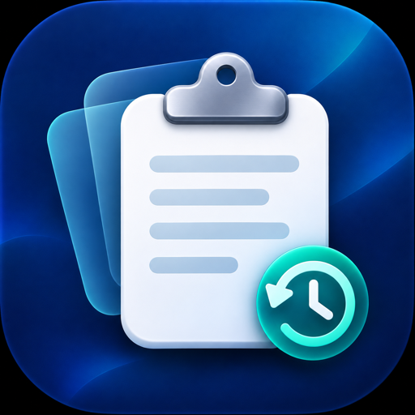

# Clipboard History

A lightweight macOS menu bar app for keeping and finding recently copied text.



## Features

- Automatically records plain-text clipboard changes. Non-text content and clipboard entries marked as concealed by compatible password managers are skipped.
- Open the history from the menu bar or with the global `⌘⇧V` shortcut.
- Search clipboard history and favorites. Click an entry to copy it again; use the arrow keys, `Return`, and `Escape` to navigate and close the history popover.
- Preserve favorites while pruning the oldest non-favorite entries when history exceeds 500 items.
- Add excluded keywords so matching copied text is not recorded.
- Optionally launch at login.
- Choose System Default, English, Traditional Chinese, Japanese, or Korean. Unsupported system languages fall back to English.
- Open Preferences or quit the app from the menu in the history popover.
- Store history locally in SQLite. Clipboard history is not synced between devices.

## Requirements

- macOS 14 Sonoma or later
- Xcode 15 or later
- [XcodeGen](https://github.com/yonaskolb/XcodeGen)

## Build

```sh
brew install xcodegen
git clone https://github.com/nickycho/clipboard-history.git
cd clipboard-history
xcodegen generate
xcodebuild -project ClipboardHistory.xcodeproj \
  -scheme ClipboardHistory \
  -configuration Debug \
  -destination 'platform=macOS' \
  CODE_SIGNING_ALLOWED=NO build
```

You can also open `ClipboardHistory.xcodeproj` in Xcode and build the `ClipboardHistory` scheme.

## Data storage

Clipboard entries are stored on the Mac in `~/Library/Application Support/ClipboardHistory/history.sqlite`. The app currently supports plain text only and does not sync clipboard data to a cloud service.
